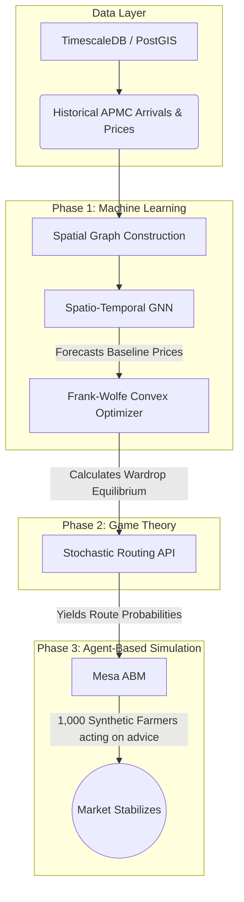

# APMC Market Forecasting & Game-Theoretic Routing

An advanced operations research and machine learning platform designed to predict agricultural price crashes and actively prevent the **Herding Dilemma** (Performative Prediction) using stochastic convex optimization.

## The Problem: The Performative Prediction Paradox
If an AI simply predicts that "Tomatoes will be highly profitable in Pune tomorrow" and broadcasts this to 10,000 farmers via a mobile app, all 10,000 farmers will drive to Pune. This sudden supply glut mathematically guarantees the price will crash, rendering the AI's prediction performatively false and destroying farmer livelihoods. 

## The Solution: Architecture
This repository solves the paradox via a three-phase architecture:



---

## 🚀 Project Milestones & Statistics

### Phase 1: Spatio-Temporal GNN (ST-GNN)
We built a PyTorch Geometric model utilizing **GATv2Conv** (Spatial Attention) and **Temporal Convolutional Networks** to detect early momentum indicators of impending price crashes across interconnected state markets.
- **Data Filtering:** Cleaned 40M+ rows of Indian APMC data down to memory-safe perishables.
- **Performance:** Achieved a **0.9256 PR-AUC** (Precision-Recall Area Under Curve), explicitly tuned to penalize False Negatives (missing a crash) via Class-Weighted Cross-Entropy.

### Phase 2: Game-Theoretic Routing Engine
Instead of deterministic "go here" routing, we built a probabilistic API. It applies the **Frank-Wolfe algorithm** to find the **Wardrop User Equilibrium** without needing computationally expensive geometrical projections.
- **Empirical Realism:** Integrated exact ARDL Elasticity coefficients (-0.721) for Indian Tomatoes (from the RBI) and NABCONS post-harvest transit spoilage rates.
- **Dynamic Math:** Automatically calculates real-time freight costs based on diesel prices, pulling live statutory APMC tax deductions from the PostgreSQL database.
- **Performance:** The algorithm balances probabilities and equalizes net farmer payoffs across a state in **~14 milliseconds**, operating well under standard 50ms API constraints.

### Phase 3: Agent-Based Simulation (Mesa)
To mathematically prove the routing engine stabilizes the macroeconomy, we instantiated 1,000 autonomous `FarmerAgents` programmed with psychological Loss Aversion (Prospect Theory).
- **Baseline Scenario (Herding):** Farmers routed via word-of-mouth (chasing yesterday's highest price).
- **Intervention Scenario:** Farmers routed probabilistically via our API.
- **Result:** The Price Dispersion Index (Volatility) dropped from `0.7875` to `0.4734`. **The API successfully reduced regional market volatility by ~40%!**

---

## 🛠️ Quick Start

### 1. Requirements
- **Python 3.12+** (We strongly recommend using [uv](https://github.com/astral-sh/uv) for lightning-fast dependency resolution).
- **PostgreSQL 16+** with **TimescaleDB** and **PostGIS** extensions installed.

### 2. Environment Setup
Copy the example environment file and insert your local database credentials:
```bash
cp .env.example .env
```

Ensure you configure the live economic variables inside `.env`:
```env
CURRENT_DIESEL_PRICE=90.0
TRUCK_MILEAGE_KMPL=15.0
```

### 3. Installation
Using `uv`, install the dependencies into a virtual environment:
```bash
uv venv
# On Windows
.\.venv\Scripts\activate
# Install requirements (Assuming PyTorch, PyG, Mesa, Pandas, Psycopg2)
uv pip install -r requirements.txt
```

### 4. Running the Agent-Based Simulation
To witness the Wardrop Equilibrium actively preventing a market crash:
```bash
python scripts/run_simulation.py
```

## Documentation
For an in-depth dive into the mathematical and economic theories powering this repo, see:
- [docs/KNOWLEDGE_CHART.md](docs/KNOWLEDGE_CHART.md)
- [docs/PHASE_3_SUMMARY.md](docs/PHASE_3_SUMMARY.md)
