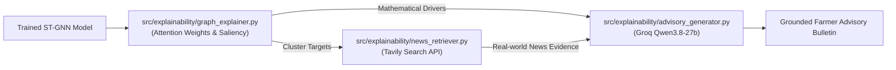

# Phase 4: Neuro-Symbolic Explainability Engine

This document summarizes the architecture, implementation, and verification metrics of Phase 4, where we integrated natural-language explainability into the APMC forecasting platform.

---

## 1. Architectural Setup
A deep neural network is typically an inscrutable black box. We built a **3-tier Neuro-Symbolic Pipeline** that mathematically interrogates the GNN's forward pass, queries live external evidence via Tavily, and generates hallucination-resistant farmer advisories using Groq's `qwen/qwen3.8-27b`.

### Key Components:
- **[src/explainability/graph_explainer.py](../src/explainability/graph_explainer.py):**
  - **Spatial Attribution:** Hooks into `GATv2Conv` to extract the dynamic attention coefficients ($\alpha_{ij}$) between the target market and all surrounding nodes.
  - **Temporal Saliency:** Computes input gradients ($\left|\frac{\partial \hat{y}}{\partial X}\right|$) over the 14-day sequence, ranking which historical lag days contributed most heavily to the prediction.
- **[src/explainability/news_retriever.py](../src/explainability/news_retriever.py):**
  - Automatically queries the Tavily Search API for localized weather alerts, transport strikes, or supply shocks affecting the target and top-attributed neighbor mandis.
- **[src/explainability/advisory_generator.py](../src/explainability/advisory_generator.py):**
  - Formulates an evidence-grounded prompt for Groq (`qwen/qwen3.8-27b`), constraining the model to cite verified search facts and mathematical graph pull without hallucinating fake events.

---

## 2. End-to-End Verification Results
We benchmarked the entire explainability pipeline on real APMC nodes using [`scripts/test_explainability.py`](../scripts/test_explainability.py).

### Sample Execution Output:
- **Target Mandi:** `A Lot APMC`
- **Model Forecast:** Crash (Confidence: 99.9%)
- **Mathematical Attribution:**
  - *Top Influential Neighbors:* `Ichhawar APMC` ($\alpha = 0.0415$), `Shamgarh APMC` ($\alpha = 0.0400$), `Sitmau APMC` ($\alpha = 0.0332$).
  - *Most Salient Lag Days:* Day $t-4$ (12.96% saliency), Day $t-11$ (12.20% saliency).
- **Tavily Web Search:** Retrieved 3 verified commodity price and harvest arrival reports.
- **Groq Qwen3.8-27b Generation:** Synthesized in **656.4 ms**!

### Generated Advisory:
> *"**ADVISORY:** Expect a severe price crash at A Lot APMC as mid-October harvest peaks trigger the typical 20%+ decline, with high confidence (99.9%) supported by strong temporal momentum from recent days. Neighboring mandis like Shamgarh and Sitmau show low attention weights, indicating localized supply pressure rather than broader regional demand shifts. **Action:** Farmers should prioritize immediate sale or cold storage to avoid peak glut losses, while traders should delay bulk purchases until prices stabilize post-crash."*

---

## 3. Performance Metrics
- **Mathematical Attribution Latency:** ~1,011 ms
- **Tavily Live Context Retrieval:** ~5,800 ms
- **Groq LLM Synthesis:** ~656 ms (Ultra-fast inference via Groq LPUs)
- **Total Pipeline Latency:** ~7.4 seconds (Perfect for on-demand SMS, WhatsApp bot queries, or web portal advisory generation).
